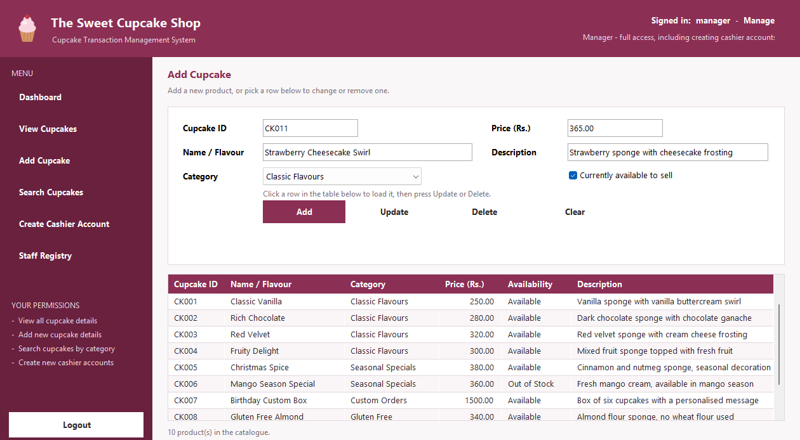
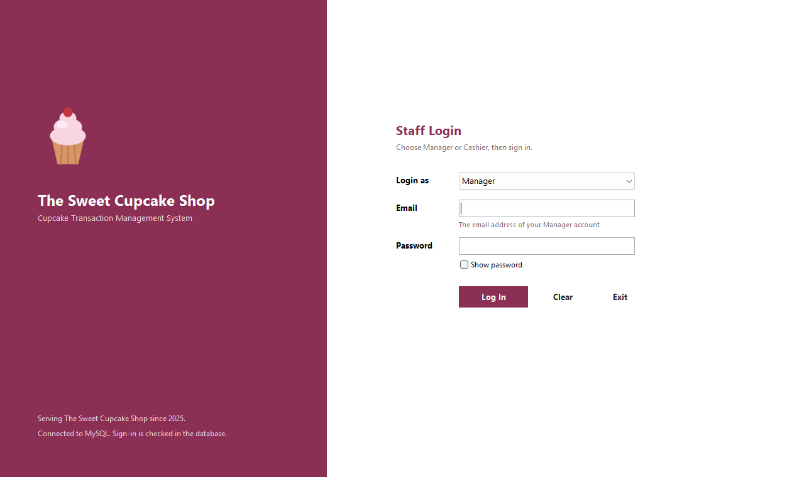
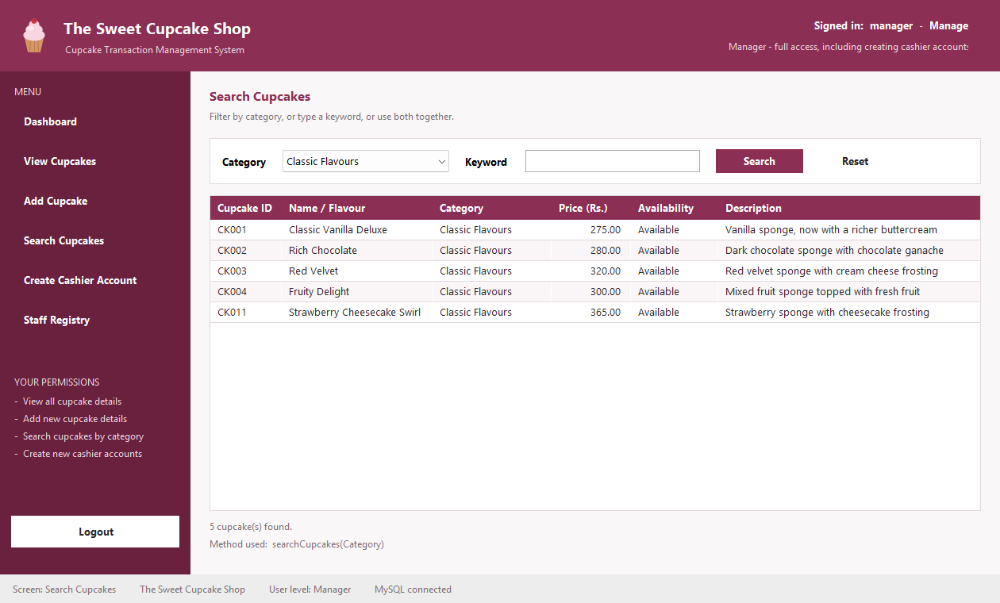
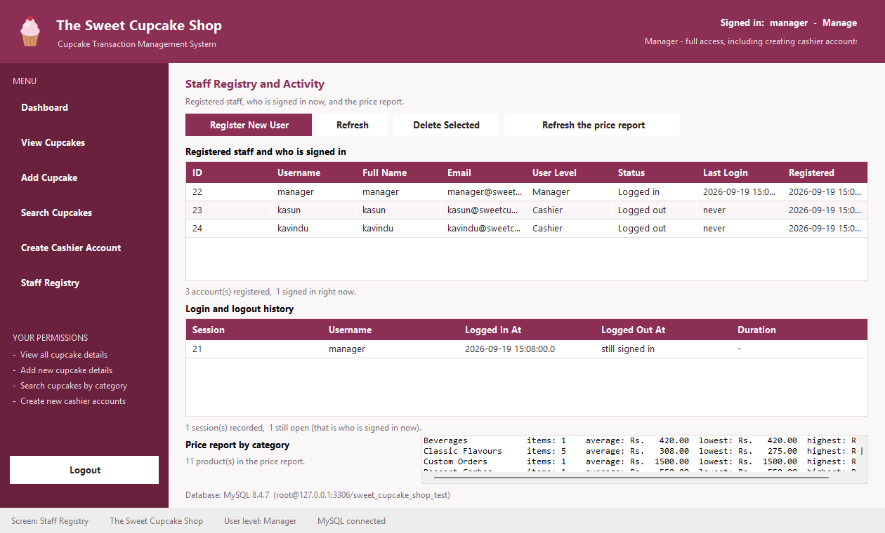

# Cupcake Management System: The Sweet Cupcake Shop

A Java Swing desktop application for **The Sweet Cupcake Shop**. Managers and Cashiers sign in to their own dashboards to manage the cupcake catalogue. Data is stored in **MySQL through JDBC**, with text-file stores that keep sign-in working when MySQL is unavailable.

Built for **CSE4006 Object Oriented Programming** (OOP assessment).



## Features

- **Role-based login.** Sign in as a Manager (by email) or a Cashier (by username), with validation and a show-password option.
- **Two dashboards in one window.** A `CardLayout` main frame swaps between the Manager and Cashier dashboards.
- **Cupcake catalogue (CRUD).** View, add, update and delete cupcakes: ID, name/flavour, category, price, availability and description.
- **Search.** By category, by keyword, or both, using overloaded service methods.
- **Cashier accounts (Manager only).** Letters-only usernames, email format checks, and duplicate usernames and emails refused.
- **Staff Registry (Manager only).** Register or remove staff, see login history, and run a SQL price report by category.
- **Resilient storage.** MySQL is the primary store. If it is not running at start-up, the app says so and signs staff in from a local file instead.
- **Security.** JDBC `PreparedStatement`s throughout, and passwords stored only as salted hashes.

## OOP concepts

| Concept | Where it shows |
|---|---|
| Inheritance | `Manager` and `Cashier` extend the abstract `User`; `CupcakeFileStore` and `UserFileStore` extend `TextFileStore` |
| Abstraction | `DataStore`, `Dashboard` and `ShopModule` interfaces |
| Polymorphism | Three overloads of `searchCupcakes()` (by category, by keyword, by both), plus overridden methods |
| Encapsulation | Model classes keep private fields and validate every value on the way in |
| Exception handling | Custom `ValidationException`, `AuthenticationException`, `AccessDeniedException` and `ShopException` |

## Tech stack

Java 21 · Java Swing (NetBeans GUI forms) · MySQL 8 · JDBC (MySQL Connector/J 8.4.0) · Maven

## Project structure

```
src/main/java/com/mycompany/oop/
├── CupcakeShopApp.java   entry point
├── model/                User, Manager, Cashier, Cupcake, Category, Role …   (8)
├── service/              AuthService, ShopService, DataSeeder, file stores … (7)
├── db/                   Database, DatabaseService, AccountDao …             (6)
├── util/                 FileHelper, PasswordUtil, Validator                  (3)
├── exception/            custom exceptions                                    (4)
└── ui/                   MainFrame, LoginPanel, dashboards and panels        (14)
```

43 classes and 11 NetBeans forms.

## Getting started

**Prerequisites:** JDK 21, Maven 3.9+ (or open the project in NetBeans), and optionally MySQL 8 (for example through WampServer).

1. **Configure the database (optional).**
   ```bash
   cp config/database.properties.example config/database.properties
   ```
   Set your MySQL host, user and password there, or put the password in the `SCS_DB_PASSWORD` environment variable, which takes priority.
2. **Build.**
   ```bash
   mvn clean package
   ```
3. **Run.**
   ```bash
   java -jar target/oop-1.0-SNAPSHOT.jar
   ```

On first run the app creates the `sweet_cupcake_shop` database and its tables (when MySQL is reachable), plus the local `data/` files, and seeds demo data:

| Role | Sign in with | Password |
|---|---|---|
| Manager | `manager@sweetcupcake.lk` | `manager123` |
| Cashier | `kasun` | `cashier123` |

## Screenshots

| Staff login | Search by category | Staff Registry & SQL report |
|---|---|---|
|  |  |  |

## UML

- [Class diagram](docs/uml/class-diagram.png)
- [Use case diagram](docs/uml/use-case-diagram.png)

## Author

**Harenthira Ravishangar**. [Portfolio](https://github.com/hari20050803-beep/Portfolio) · [LinkedIn](https://www.linkedin.com/in/harenthira)
